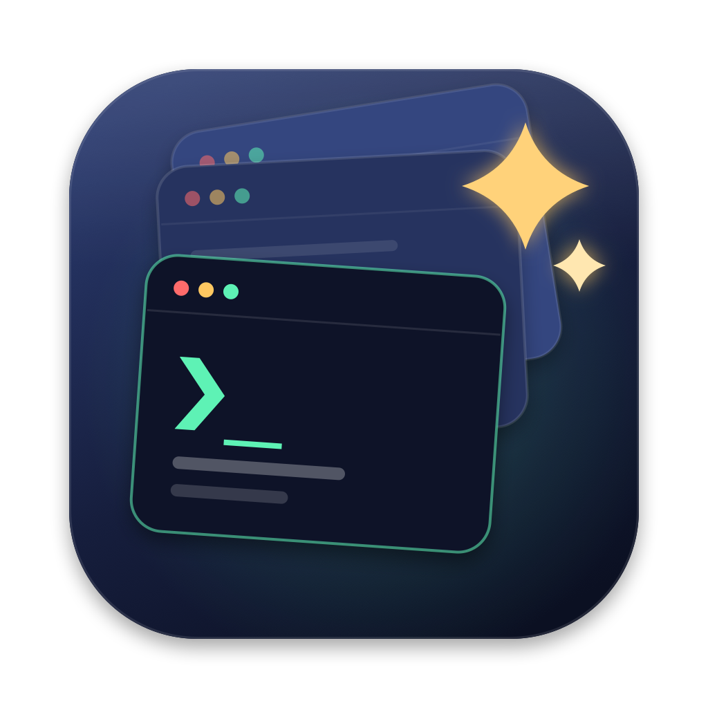
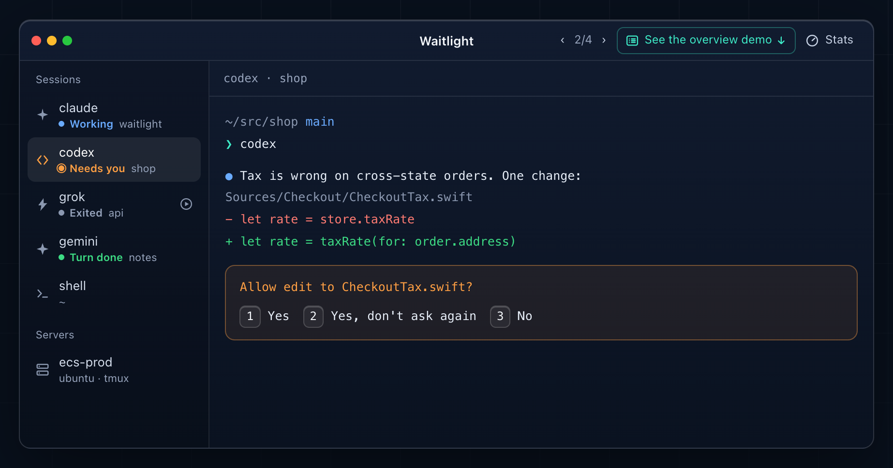

<p align="center">
  
</p>

<h1 align="center">Waitlight</h1>

<p align="center">
  <strong>One window for every coding agent.</strong><br>
  Run Claude Code, Codex, Gemini and more side by side on your Mac, locally or over SSH,<br>
  and see at a glance which one needs you.
</p>

<p align="center">
  <a href="https://github.com/CassianFlorin/Waitlight/releases/latest"></a>
  
  <a href="#install"></a>
  <a href="LICENSE"></a>
</p>

<p align="center">
  <a href="https://waitlight.cassianflorin.com/en/"><b>Website</b></a> ·
  <a href="https://github.com/CassianFlorin/Waitlight/releases/latest"><b>Download</b></a> ·
  <a href="docs/FEATURES.md"><b>All features</b></a> ·
  <a href="README.zh-CN.md"><b>中文</b></a>
</p>

<p align="center">
  <a href="https://waitlight.cassianflorin.com/en/">
    
  </a>
  <br>
  <sub>The <a href="https://waitlight.cassianflorin.com/en/">website</a> has a clickable version of this sketch.</sub>
</p>

**Waitlight is a native macOS app for running multiple AI coding agents (Claude Code, Codex, Gemini and more) side by side, locally or over SSH, with one sidebar that shows which agent needs you.**

> Waitlight was called **AgentDeck** before 0.10. Installed copies update in place and keep their sessions, servers and settings.

Coding with AI agents usually means running several at once: Claude Code in one repo, Codex in another, a third on a server. That quickly turns into a pile of terminal tabs, and you keep checking which agent is still working, which one is stuck on a permission prompt, and where a conversation went after the window closed. Waitlight puts them in one window and tells you which ones need you.

## Highlights

<table>
  <tr>
    <td width="50%" valign="top">
      <h3>🚦 See who needs you</h3>
      Every agent shows whether it is <b>working</b>, <b>waiting for you</b>, <b>done with its turn</b> or <b>exited</b>. <code>⌘⇧J</code> jumps straight to the next one that is waiting.
    </td>
    <td width="50%" valign="top">
      <h3>🗂️ Every agent on one screen</h3>
      The Agent overview (<code>⇧⌘A</code>) lists all agents across sessions, waiting ones first. Read their last lines, answer a prompt, stop a turn, or hand out a new task without leaving the list.
    </td>
  </tr>
  <tr>
    <td width="50%" valign="top">
      <h3>🌐 Local and remote together</h3>
      Hosts from <code>~/.ssh/config</code> sit next to your local sessions. With tmux or zellij on the server, a dropped connection reattaches with the agent still running. Nothing is installed on the server.
    </td>
    <td width="50%" valign="top">
      <h3>♻️ Pick up where you were</h3>
      Sessions, splits, groups and SSH connections come back after a relaunch, and agents return to the same conversation. <code>⇧⌘O</code> lists past conversations for a folder.
    </td>
  </tr>
  <tr>
    <td width="50%" valign="top">
      <h3>🔍 Your agents, detected</h3>
      Waitlight finds the agent CLIs on your login shell's PATH and lists only those. Missing ones install from inside the app, and any other CLI can be added.
    </td>
    <td width="50%" valign="top">
      <h3>⌨️ A real terminal</h3>
      Every pane is Ghostty, with your config, themes and keybinds. Splits, find, CJK input, screenshots pasted as paths, and a performance panel with Docker for the Mac or the server.
    </td>
  </tr>
</table>

## Supported agents

| Agent | Restores its conversation | Hand out tasks | Status comes from |
| --- | :---: | :---: | --- |
| **Claude Code** | ✅ exact | ✅ | hooks, built in |
| **Codex** | ✅ exact | ✅ | hooks, opt-in |
| **Grok** | ✅ exact | ✅ | hooks, opt-in |
| **Gemini** | latest | ✅ | terminal signals |
| **opencode** | latest | ✅ | terminal signals |
| **Qwen Code** | latest | ✅ | terminal signals |
| **Cursor CLI** | latest | ✅ | terminal signals |
| **Copilot CLI** | latest | ✅ | terminal signals |
| **Droid** | latest | ✅ | terminal signals |
| **Aider** | latest | — | terminal signals |
| **Amp** | — | — | terminal signals |
| **Crush** | — | — | terminal signals |
| *Any other CLI* | your arguments | your arguments | terminal signals |

<sub><b>exact</b> returns to the same conversation by id; <b>latest</b> continues the most recent one in the folder. <b>Hooks</b> means the agent reports its own state: Claude Code's are passed at launch without touching your settings, and Codex and Grok can be switched on in Manage Agents. <b>Terminal signals</b> are Return, the bell, notifications, progress and the agent exiting.</sub>

## Install

```bash
brew install --cask cassianflorin/tap/waitlight
```

Or download the DMG from [Releases](https://github.com/CassianFlorin/Waitlight/releases/latest). It is signed with a Developer ID and notarized by Apple, and updates itself from then on. Requires **macOS 14 or later on Apple silicon**.

## Keys

| | |
| --- | --- |
| <kbd>⌘</kbd> <kbd>⇧</kbd> <kbd>J</kbd> | Jump to the next session that needs you |
| <kbd>⇧</kbd> <kbd>⌘</kbd> <kbd>A</kbd> | Agent overview |
| <kbd>⌥</kbd> <kbd>⌘</kbd> <kbd>[</kbd> / <kbd>]</kbd> | Previous / next agent, across sessions |
| <kbd>⌘</kbd> <kbd>D</kbd> / <kbd>⌘</kbd> <kbd>⇧</kbd> <kbd>D</kbd> | Split right / down |
| <kbd>⇧</kbd> <kbd>⌘</kbd> <kbd>O</kbd> | Resume an earlier conversation for this folder |
| <kbd>⌘</kbd> <kbd>⇧</kbd> <kbd>R</kbd> | Reconnect SSH |

The full list is in [docs/FEATURES.md](docs/FEATURES.md).

## FAQ

<details>
<summary><b>Do I need to install anything on my servers?</b></summary>
<br>
No. Waitlight uses plain SSH, and the hosts in <code>~/.ssh/config</code> just work. If the server has tmux or zellij, Waitlight uses it, so a dropped connection reattaches with the agent still running.
</details>

<details>
<summary><b>How is it different from tabs in iTerm or tmux?</b></summary>
<br>
The terminal is still a terminal (Ghostty). What Waitlight adds is each agent's state, a single overview to reply and hand out tasks from, and agents that return to the same conversation after a relaunch.
</details>

<details>
<summary><b>Does it change my agent settings?</b></summary>
<br>
No. Claude Code's hooks are passed with <code>--settings</code> at launch. The status hooks for Codex and Grok are opt-in; turning one on writes a single file of Waitlight's own, and turning it off deletes it.
</details>

<details>
<summary><b>Does it collect any data?</b></summary>
<br>
No. There is no analytics or telemetry. The only connection Waitlight makes on its own is checking GitHub Releases for updates.
</details>

More on the [website](https://waitlight.cassianflorin.com/en/#faq).

## Build from source

<details>
<summary>Xcode 16+, <a href="https://github.com/yonaskolb/XcodeGen">XcodeGen</a> and Zig</summary>
<br>

```bash
git clone --recursive https://github.com/CassianFlorin/Waitlight.git
cd Waitlight
scripts/build-ghosttykit.sh && scripts/fetch-sparkle.sh
xcodegen && open Waitlight.xcodeproj
```

Troubleshooting and the release process are in [docs/DEVELOPMENT.md](docs/DEVELOPMENT.md). Contributions are welcome; see [CONTRIBUTING.md](CONTRIBUTING.md).
</details>

## About

Waitlight is a personal tool, built for my own workflow and open-sourced in case it fits yours. Issues and ideas are welcome.

The terminal engine is [Ghostty](https://github.com/ghostty-org/ghostty) by Mitchell Hashimoto and contributors (MIT). Updates are delivered with [Sparkle](https://sparkle-project.org). Waitlight is MIT licensed; see [LICENSE](LICENSE) and [THIRD_PARTY_NOTICES.md](THIRD_PARTY_NOTICES.md).
