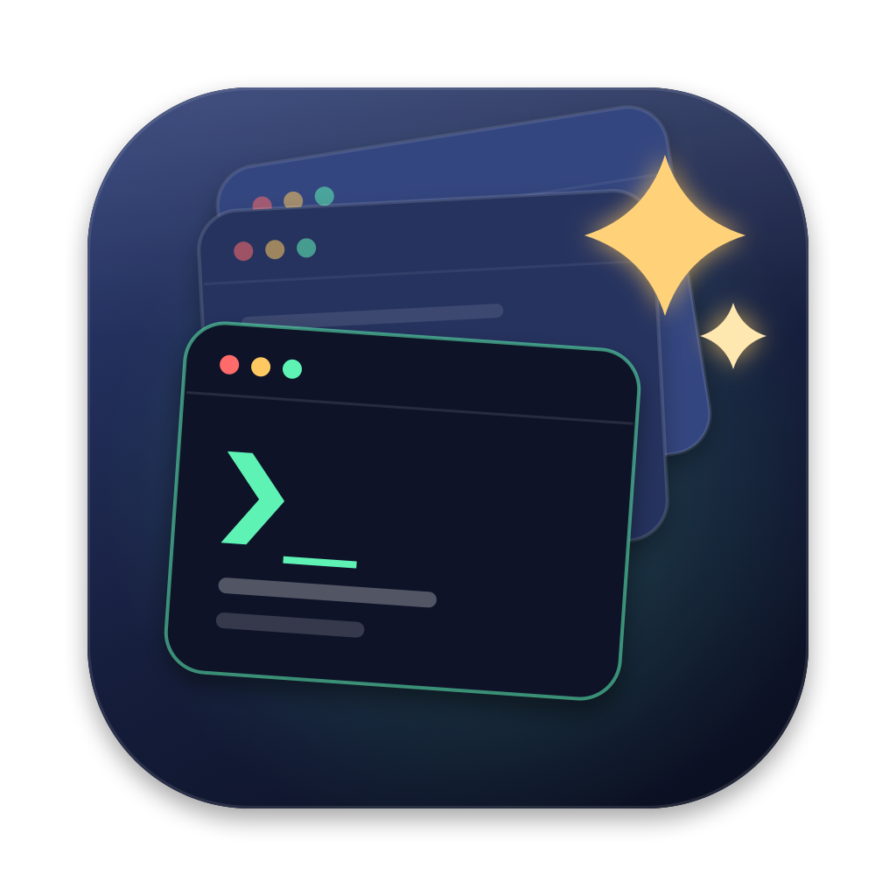

<p align="center">
  
</p>

# AgentDeck

A native macOS workbench for running several AI coding agents (Claude Code, Codex, Grok, Gemini, any CLI agent, or a plain shell) side by side, locally or on your servers, built on [libghostty](https://ghostty.org).

You get one window and a sidebar of sessions. Each session is a real Ghostty terminal running in its own folder. When an agent rings the bell or sends a desktop notification (it finished, or it needs permission) while you're looking at a different session, that session gets an orange dot and the Dock icon gets a badge.

> Status: early skeleton (v0.1). Expect rough edges.

## Features

- **Sessions sidebar.** Every session keeps running in the background. Switch with `⌘⇧[` / `⌘⇧]`.
- **Agents.** Built-in presets for Claude Code, Codex, Grok and Gemini, plus your own (any CLI) in 管理 Agent. AgentDeck checks your login shell's PATH to show which are installed, and gives the install command for the rest. The agent command is typed into your login shell, so you drop back to a working shell when the agent exits.
- **Per-agent status.** The sidebar shows 运行中 / 等你 / 本轮完成 / 已退出 for each agent session. Claude Code reports exactly via its hooks: AgentDeck passes `--settings` at launch and never edits your settings files. Other agents are tracked from generic signals: Return pressed, bell and OSC 9/777 notifications (which also set a Dock badge), OSC 9;4 progress, and the agent exiting. `⌘⇧J` jumps to the next session that needs you.
- **Your Ghostty config just works.** AgentDeck loads `~/.config/ghostty/config`, so your fonts, themes and keybinds carry over.
- **IME support.** Chinese, Japanese and Korean input methods work, with the candidate window anchored at the cursor.
- **Splits.** `⌘D` / `⌘⇧D` split right/down; `⌘[` `⌘]` or `⌘⌥←↑↓→` move between panes; `⌘⌃←↑↓→` resize; `⌘⇧↩` zoom; `⌃⌘=` equalize. New panes inherit the current folder. Layouts are restored on relaunch.
- **Find & scrollback.** `⌘F` to find, `↩` / `⇧↩` (or `⌘G` / `⇧⌘G`) to step through matches, with a match counter. `⌘E` searches the current selection. An overlay scroll indicator can be dragged. `⌘↑` / `⌘↓` jump between prompts.
- **Paste images and files.** `⌘V` with a screenshot on the clipboard saves it as a PNG and pastes its path, which is how you hand an agent an image. Copied or dragged files paste as shell-escaped paths.
- **Rename & group sessions.** Right-click a session to rename it or move it into a group. Groups are collapsible sidebar sections. `⌘1`–`⌘9` jump to a session.
- **Remote servers (ECS / VPS / any SSH host).** The sidebar's 服务器 section lists saved servers plus every alias in `~/.ssh/config`, including `Include`d files, so hosts you already configured just work. Add or edit a server with name, address, user, port, key / ssh-agent / password (stored in the Keychain), ProxyJump, login directory, TERM and extra ssh args. A live command preview and a "测试连接" button show the OS, whether tmux/zellij is installed, and existing sessions.
- **Nothing to install on the server.** By default (自动), AgentDeck uses tmux or zellij if the server happens to have one, and otherwise a plain login shell, with no warning. If a disconnect hits a session that runs in tmux/zellij, reconnecting re-attaches, so whatever was running, an agent included, is still there. Without a multiplexer, reconnecting simply logs in again, in the configured directory. Either way the session shows 已断开 with a reconnect button (`⌘⇧R`), and SSH sessions reconnect automatically on relaunch. You can also force tmux or zellij per server, or attach to an existing tmux/zellij session.
- **Ghostty's ssh integration works.** With `shell-integration-features = ssh-terminfo,ssh-env`, typing `ssh` in AgentDeck behaves like it does in Ghostty. AgentDeck bundles a `ghostty` entry point that runs Ghostty's CLI actions.
- **Resume conversations.** Each session remembers its agent conversation. Claude Code and Grok get an id from AgentDeck at launch; for Codex, AgentDeck finds the id in `~/.codex/sessions` after launch. Relaunching AgentDeck, or restarting an agent that exited, resumes the same conversation (`--resume <id>` / `codex resume <id>`). `⇧⌘O` 恢复之前的对话 lists an agent's past conversations for a folder, with titles, read from the agent's own session store.
- **Restore on relaunch.** Sessions, splits, groups and SSH connections come back as they were, as fresh processes.

## Roadmap

1. **Shell.** A solid everyday terminal: tabs/splits, search, scrollback, image paste, session rename and grouping.
2. **Remote servers (ECS / VPS / any SSH host).** Saved host configs with an editor for adding them, connect in one click, and restore sessions after reconnecting (tmux/zellij attach).
3. **Agent shells.** First-class management for Claude Code, Codex, Grok, Gemini and others: presets, per-agent status, resuming previous conversations.

## Build

Requirements: macOS 14+, Xcode 16+, [XcodeGen](https://github.com/yonaskolb/XcodeGen), and Zig (the version in `vendor/ghostty/build.zig.zon` → `minimum_zig_version`).

```bash
git clone --recursive https://github.com/CassianFlorin/AgentDeck.git
cd AgentDeck
scripts/build-ghosttykit.sh      # builds vendor/GhosttyKit.xcframework (~5 min first time)
xcodegen
open AgentDeck.xcodeproj
```

On Xcode 26 and later, the Metal compiler is a separate component. Install it once:

```bash
xcodebuild -downloadComponent MetalToolchain
```

Troubleshooting:

- **Zig's fetch fails.** You might see `400 Bad Request` behind an HTTP proxy, or `hash mismatch` / `DirNotEmpty` on some macOS versions. Prefetch the dependencies with curl (which respects `https_proxy`), then build without Zig's own network access:

  ```bash
  scripts/prefetch-zig-deps.sh
  ZIG_SYSTEM_DIR=vendor/zig-deps/pkg scripts/build-ghosttykit.sh
  ```

- **`hash mismatch` after an interrupted build.** Run `CLEAN=1 scripts/build-ghosttykit.sh`.

## Releases

Download the latest DMG from [Releases](../../releases). Builds are signed with a Developer ID and notarized by Apple, and they run on Apple silicon with macOS 14 or later.

Maintainers:

- **CI** (`.github/workflows/ci.yml`) builds every push and PR. GhosttyKit is cached by submodule commit and Zig version.
- **Release** (`.github/workflows/release.yml`) runs on a `v*` tag. It builds, signs with Developer ID, notarizes and staples the app and the DMG, then publishes a GitHub Release with the DMG, a ZIP and SHA-256 checksums:

  ```bash
  git tag v0.1.0 && git push origin v0.1.0
  ```

- One-time setup: `scripts/setup-ci-secrets.sh` stores the Developer ID `.p12` and the App Store Connect API key as repository secrets. It prompts for the p12 password and the Issuer ID.
- Local release: `NOTARY_KEY_PATH=… NOTARY_KEY_ID=… NOTARY_ISSUER_ID=… scripts/package.sh 0.1.0` puts its output in `build/dist`. Without the notary variables you get signed but `-unnotarized` artifacts, which aren't meant for distribution.

## Claude Code tip

AgentDeck already gets Claude Code's status from hooks. If you also want a terminal bell when Claude waits for you (useful outside AgentDeck too), run:

```bash
claude config set --global preferredNotifChannel terminal_bell
```

## Credits

The terminal engine is [Ghostty](https://github.com/ghostty-org/ghostty) by Mitchell Hashimoto and contributors (MIT). The input and IME handling is adapted from Ghostty's macOS app.

## License

MIT. See [LICENSE](LICENSE).
