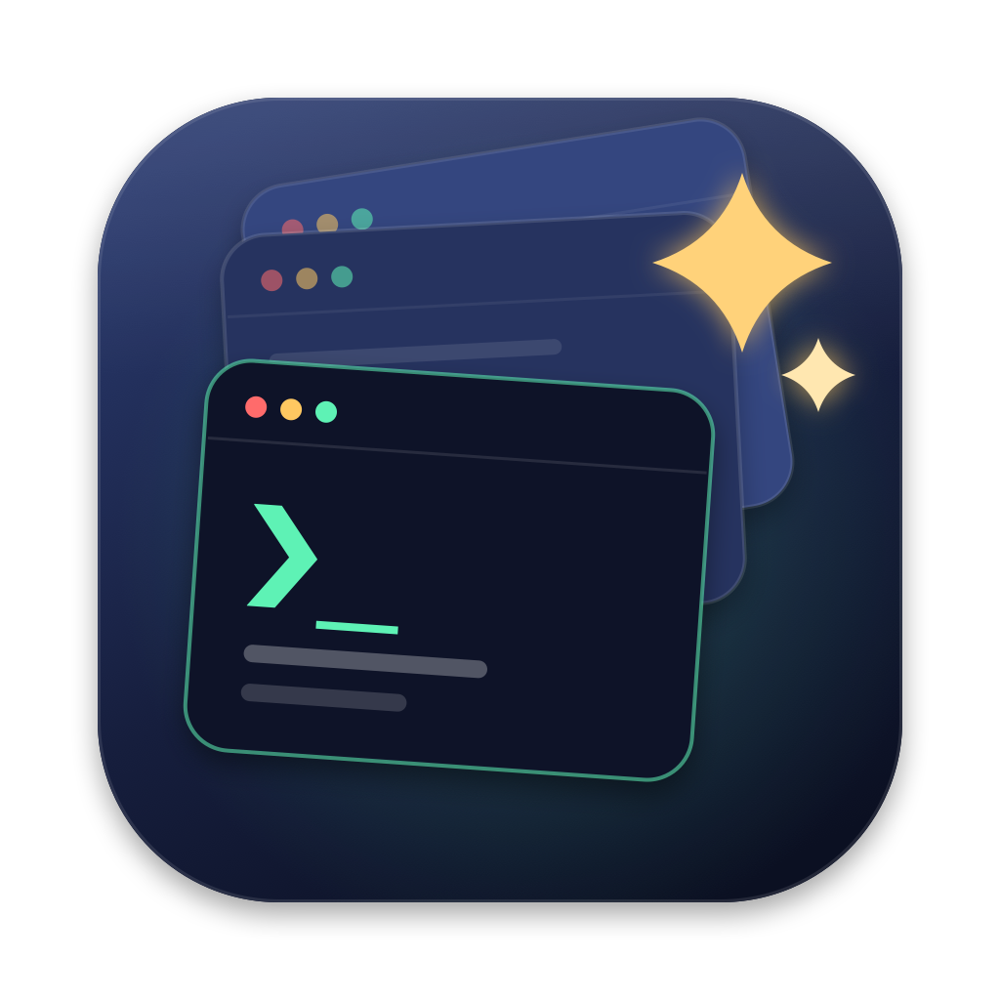
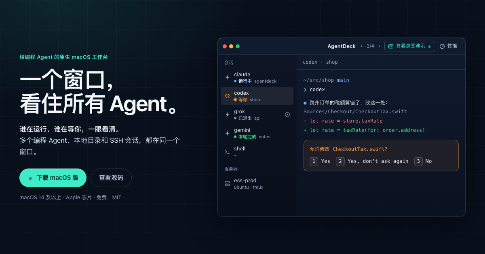

<p align="center">
  
</p>

<h1 align="center">AgentDeck</h1>

<p align="center">
  <strong>一个窗口，看住所有编程 Agent。</strong><br>
  在 Mac 上并排运行 Claude Code、Codex、Gemini 等 Agent，本地和 SSH 都行，<br>
  哪个在等你，一眼就能看到。
</p>

<p align="center">
  <a href="https://github.com/CassianFlorin/AgentDeck/releases/latest"></a>
  
  <a href="#安装"></a>
  <a href="LICENSE"></a>
</p>

<p align="center">
  <a href="https://agentdeck.cassianflorin.com"><b>官网</b></a> ·
  <a href="https://github.com/CassianFlorin/AgentDeck/releases/latest"><b>下载</b></a> ·
  <a href="docs/FEATURES.md"><b>全部功能（英文）</b></a> ·
  <a href="README.md"><b>English</b></a>
</p>

<p align="center">
  <a href="https://agentdeck.cassianflorin.com">
    
  </a>
  <br>
  <sub><a href="https://agentdeck.cassianflorin.com">官网</a>上有这张示意图的可交互版本。</sub>
</p>

**AgentDeck 是一个原生 macOS 应用，用来并排运行多个 AI 编程 Agent（Claude Code、Codex、Gemini 等），本地和 SSH 服务器上的都行，一条侧边栏告诉你哪个 Agent 在等你。**

用 AI 写代码，往往是好几个 Agent 一起跑：一个仓库里开着 Claude Code，另一个开着 Codex，服务器上还有一个。终端标签页越开越多，你得来回翻：哪个还在跑，哪个卡在权限确认上等你，窗口关掉以后那段对话又去哪了。AgentDeck 把它们放进一个窗口，并告诉你哪个在等你。

## 亮点

<table>
  <tr>
    <td width="50%" valign="top">
      <h3>🚦 谁在等你，一眼看清</h3>
      每个 Agent 都有状态：<b>运行中</b>、<b>等你</b>、<b>本轮完成</b>、<b>已退出</b>。<code>⌘⇧J</code> 直接跳到下一个在等你的。
    </td>
    <td width="50%" valign="top">
      <h3>🗂️ 所有 Agent 列在一屏</h3>
      Agent 总览（<code>⇧⌘A</code>）列出所有会话里的 Agent，等你的排最前。不用切过去就能看最后几行、回答提示、停下这一轮，或者派一个新任务。
    </td>
  </tr>
  <tr>
    <td width="50%" valign="top">
      <h3>🌐 本地和远程在一起</h3>
      <code>~/.ssh/config</code> 里的服务器就排在本地会话旁边。服务器上有 tmux 或 zellij 就用上，断线重连后 Agent 还在原地跑。服务器上不用装任何东西。
    </td>
    <td width="50%" valign="top">
      <h3>♻️ 接着之前的工作</h3>
      重启 App 后，会话、分屏、分组和 SSH 连接按原样回来，Agent 回到同一段对话。<code>⇧⌘O</code> 按文件夹列出以前的对话。
    </td>
  </tr>
  <tr>
    <td width="50%" valign="top">
      <h3>🔍 自动检测装了哪些 Agent</h3>
      AgentDeck 在登录 shell 的 PATH 里找 Agent 命令行工具，菜单里只列找到的。没装的在 App 里一键安装，其他命令行工具也可以自己加。
    </td>
    <td width="50%" valign="top">
      <h3>⌨️ 真正的终端</h3>
      每一格都是 Ghostty，沿用你的配置、主题和快捷键。分屏、查找、中日韩输入法、截图贴成路径，还有带 Docker 的性能面板，看的是当前所在的 Mac 或服务器。
    </td>
  </tr>
</table>

## 支持的 Agent

| Agent | 恢复对话 | 派发任务 | 状态来源 |
| --- | :---: | :---: | --- |
| **Claude Code** | ✅ 精确 | ✅ | hooks，内置 |
| **Codex** | ✅ 精确 | ✅ | hooks，需手动开启 |
| **Grok** | ✅ 精确 | ✅ | hooks，需手动开启 |
| **Gemini** | 最近一段 | ✅ | 终端信号 |
| **opencode** | 最近一段 | ✅ | 终端信号 |
| **Qwen Code** | 最近一段 | ✅ | 终端信号 |
| **Cursor CLI** | 最近一段 | ✅ | 终端信号 |
| **Copilot CLI** | 最近一段 | ✅ | 终端信号 |
| **Droid** | 最近一段 | ✅ | 终端信号 |
| **Aider** | 最近一段 | — | 终端信号 |
| **Amp** | — | — | 终端信号 |
| **Crush** | — | — | 终端信号 |
| *其他命令行工具* | 自己填参数 | 自己填参数 | 终端信号 |

<sub><b>精确</b>是按对话 id 回到同一段；<b>最近一段</b>是接着这个文件夹里最近的那段对话。<b>hooks</b> 是 Agent 自己报告状态：Claude Code 的在启动时带上，不改你的设置文件；Codex 和 Grok 的要在「管理 Agent」里打开。<b>终端信号</b>是回车、响铃、通知、进度和 Agent 退出。</sub>

## 安装

```bash
brew install --cask cassianflorin/tap/agentdeck
```

也可以从 [Releases](https://github.com/CassianFlorin/AgentDeck/releases/latest) 下载 DMG。已用 Apple Developer ID 签名并通过公证，装好后会自己更新。需要 **macOS 14 或更新版本，Apple 芯片**。

## 快捷键

| | |
| --- | --- |
| <kbd>⌘</kbd> <kbd>⇧</kbd> <kbd>J</kbd> | 跳到下一个等你的会话 |
| <kbd>⇧</kbd> <kbd>⌘</kbd> <kbd>A</kbd> | 打开 Agent 总览 |
| <kbd>⌥</kbd> <kbd>⌘</kbd> <kbd>[</kbd> / <kbd>]</kbd> | 上一个 / 下一个 Agent，跨会话 |
| <kbd>⌘</kbd> <kbd>D</kbd> / <kbd>⌘</kbd> <kbd>⇧</kbd> <kbd>D</kbd> | 向右 / 向下分屏 |
| <kbd>⇧</kbd> <kbd>⌘</kbd> <kbd>O</kbd> | 恢复这个文件夹里以前的对话 |
| <kbd>⌘</kbd> <kbd>⇧</kbd> <kbd>R</kbd> | 重新连接 SSH |

完整列表见 [docs/FEATURES.md](docs/FEATURES.md)（英文）。

## 常见问题

<details>
<summary><b>服务器上要装东西吗？</b></summary>
<br>
不用。AgentDeck 走普通的 SSH，<code>~/.ssh/config</code> 里的服务器直接能用。服务器上有 tmux 或 zellij 就会用上，断线重连后 Agent 还在原地跑。
</details>

<details>
<summary><b>和在 iTerm 或 tmux 里多开几个标签有什么区别？</b></summary>
<br>
终端还是那个终端（Ghostty）。多出来的是每个 Agent 的状态、一个能直接回复和派任务的总览，以及重启 App 后回到同一段对话。
</details>

<details>
<summary><b>会改我的 Agent 配置吗？</b></summary>
<br>
不会。Claude Code 的 hooks 在启动时用 <code>--settings</code> 传进去。Codex 和 Grok 的状态 hook 要你自己打开，它只写一份 AgentDeck 自己的文件，关掉就删除。
</details>

<details>
<summary><b>会收集我的数据吗？</b></summary>
<br>
不会。AgentDeck 没有统计和遥测，唯一主动的联网是检查更新时读取 GitHub Releases。
</details>

更多问题见[官网](https://agentdeck.cassianflorin.com/#faq)。

## 从源码构建

<details>
<summary>需要 Xcode 16+、<a href="https://github.com/yonaskolb/XcodeGen">XcodeGen</a> 和 Zig</summary>
<br>

```bash
git clone --recursive https://github.com/CassianFlorin/AgentDeck.git
cd AgentDeck
scripts/build-ghosttykit.sh && scripts/fetch-sparkle.sh
xcodegen && open AgentDeck.xcodeproj
```

常见问题和发版流程见 [docs/DEVELOPMENT.md](docs/DEVELOPMENT.md)。欢迎贡献，见 [CONTRIBUTING.md](CONTRIBUTING.md)。
</details>

## 关于

AgentDeck 是照着我自己的工作流做的，开源出来，也许正好适合你。欢迎提 issue 和想法。

终端引擎是 Mitchell Hashimoto 和贡献者们的 [Ghostty](https://github.com/ghostty-org/ghostty)（MIT）。应用内更新用的是 [Sparkle](https://sparkle-project.org)。AgentDeck 采用 MIT 许可，见 [LICENSE](LICENSE) 和 [THIRD_PARTY_NOTICES.md](THIRD_PARTY_NOTICES.md)。
